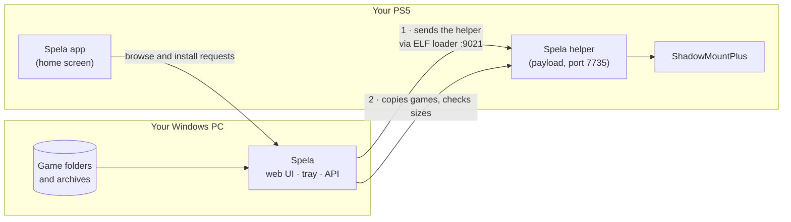

<div align="center">


**A storefront for your own PS5 game backups.**
Browse them on your PC, install them to your console over your home network, remove them again.

[](https://github.com/ensamvarg360/spela/releases/latest)
[](https://github.com/ensamvarg360/spela/actions/workflows/ci.yml)
[](LICENSE)

[](#credits)


</div>

*Spela* is Swedish for "play". It's a single-user app that lives on your PC, keeps a catalog of the PS5 game dumps you've backed up, and copies them to a PS5 that already runs homebrew, through [ShadowMountPlus](https://github.com/drakmor/ShadowMountPlus). It also puts a small **Spela app on the console's home screen**, so you can pick and install games with the controller, from the couch.

> [!IMPORTANT]
> ## Spela does not provide games. Ever.
> It contains no game files, no keys, no firmware and no Sony code. It can't download games, search for them or point you to them, and it never will. It only works with files that **you** already have on your own PC, from backups **you** made of games **you** own. The only game data it ever moves is *your* files, from *your* PC to *your* console on *your* network.
> It is not affiliated with or endorsed by Sony Interactive Entertainment. See [Legal](#legal).

## What it does

**Your library**

- **Finds your games.** Point it at a folder or a whole drive. It recognizes folder dumps, disc images (`.exfat`, `.ffpkg`, `.ffpfs`, `.ffpfsc`) and `.zip` / `.7z` / `.rar` archives holding them by looking *inside* the files, not just at their names. Anything it can't identify is flagged, never guessed.
- **Looks the part.** Posters, publisher, release year, genre and rating come from PlayStation Store by title ID, no account needed. Prefer your own cover? Upload it.
- **Keeps DLC apart.** DLC gets its own page and folders, and unlockers can be added straight into an installed game's folder.
- **Converts folder dumps** to a single `.exfat` image in plain Python: no OSFMount, WSL or admin rights.

**Your console**

- **Installs over your network.** Click one game, or select a dozen and queue them all, to copy them to the internal SSD or a USB drive. Each copy goes in under a hidden name, every file's size is checked, and only then is it renamed into place, so ShadowMountPlus never sees half a game. One title ID per console, so two versions can't clash.
- **Removes cleanly.** Deleting a ShadowMountPlus game on the PS5 leaves its files behind. Spela shows exactly what it will delete, deletes only that, and takes the home-screen tile with it.
- **Moves games** between the console's drives without anything crossing the network, or back onto your PC when the console runs out of room.
- **Tidies up.** Unfinished copies left by an install that stopped partway are found and can be cleaned up in one click.
- **Fixes the home screen.** Installed games get their proper logo, which a jailbroken console can't fetch for itself.
- **Backs up and restores save data** between the console and your PC, and asks (and backs up the current save) before it replaces one.
- **Wakes the console** from rest mode, and sends its helper again by itself after the console restarts.

**From the couch**

- **A Spela app on the PS5 home screen.** Games, Installed and DLC tabs plus a cart on the TV: Cross installs, Square stops or removes, and you pick the drive. R2 favorites a game so it comes first, and L2 sorts by name, newest or size.

**Day to day**

- **Keeps you posted.** A Dashboard shows library totals, each console's status and free space, and anything that needs a look. A bell in the top bar lists what finished while you were away.
- **Updates in one click.** When a new release is out, **Update to vX.Y.Z** in the top bar downloads it and restarts Spela, keeping your library and settings. The helper and the PS5 app update themselves after it.
- **Stays private.** Runs in the tray, answers only to your PC by default, and can give a phone or a guest a view-only password.

## Screenshots

<table>
  <tr>
    <td width="50%"><br><sub><b>Dashboard</b>: what's in the library, how each console and drive is doing, and what needs a look.</sub></td>
    <td width="50%"><br><sub><b>Game page</b>: pick a drive and install, add it to the cart, convert it, and see exactly where the files came from.</sub></td>
  </tr>
  <tr>
    <td width="50%"><br><sub><b>On the PS5</b>: the games on your PC, with what's installed, updatable or in progress.</sub></td>
    <td width="50%"><br><sub><b>Pick a drive</b> and press Cross. The one with the most free space is chosen for you.</sub></td>
  </tr>
  <tr>
    <td colspan="2" align="center"><br><sub><b>Setup guide</b>: the first run, one step at a time, picking up where you left off.</sub></td>
  </tr>
</table>

<sub>The screenshots show invented games with invented posters, kept in `docs/screenshots/demo-covers/`. `docs/screenshots/make_screenshots.py` rebuilds the PC ones from a demo library, and `./console-app/build.ps1 -Preview` renders the PS5 ones.</sub>

## What you need

- A **Windows 10 or 11** PC, or a **NAS or Linux box with Docker** (Unraid, ZimaOS, CasaOS, Synology…): see [Run it on a NAS](#run-it-on-a-nas-docker).
- A **PS5 that already runs homebrew**: an ELF loader listening on port 9021 and ShadowMountPlus (1.7 or later for the cleanest removals). Spela doesn't jailbreak anything and can't help you do it.
- The PC and the console on the **same home network**.

## Get started

1. Download **`Spela-<version>.zip`** from the [latest release](https://github.com/ensamvarg360/spela/releases/latest), extract it (right-click, **Extract All**) and double-click **Spela.exe** in the Spela folder. There's nothing to install. Windows may show a SmartScreen warning because the app isn't code-signed; the release has a `SHA256SUMS.txt` to check your download against.
2. Choose an admin password. The **setup guide** opens and takes you through the rest, one step at a time:
   - add your game folder (or a whole drive such as `G:\`) and scan it
   - add your PS5: Spela can find it on your network, or you type its IP address
   - run your jailbreak's ELF loader, and Spela sends its helper to the PS5 by itself

   You can leave halfway: the guide remembers where you got to, and stays on the Dashboard until you're done. When something goes wrong, it says what to check. Then open a game and click **Install**.
3. Optional: click **Install PS5 app** under **Settings → Consoles** to get Spela on the console's home screen.

You only download Spela once: later releases show up as **Update to vX.Y.Z** in the top bar.

Nothing needs changing in Windows: the PC only ever connects out to the PS5, and the PS5 app reaches the PC through the helper, so no firewall rule or network setting is involved.

Everything Spela knows is kept in `%LOCALAPPDATA%\Spela`. Your game files never are. The full walkthrough, backups, and a troubleshooting table are in the **[user guide](docs/user-guide.md)**.

## Run it on a NAS (Docker)

Spela also comes as a Docker image, `ghcr.io/ensamvarg360/spela`, built from the same code as each Windows release. It's the same app without the window and tray icon: you use it from a browser on any device in your home.

**ZimaOS / CasaOS**

1. **App Store → + → Install a customized app → Import**, and paste [docker-compose.yml](docker-compose.yml).
2. In the form, set **/games** to the folder with your PS5 games. Leave **/data** as it is.
3. Click **Install**, then open Spela from its icon and choose an admin password.

**Unraid**

Search for **Spela** under **Apps**, click **Install**, set **Games** to your games share (for example `/mnt/user/games`), and click **Apply**. Then open the WebUI and choose an admin password.

Not listed there yet? Save [unraid/spela.xml](unraid/spela.xml) as `/boot/config/plugins/dockerMan/templates-user/my-spela.xml` on the server, then go to **Docker → Add Container** and pick **spela** under **Template**.

**Anywhere else**

Copy [docker-compose.yml](docker-compose.yml), change the two folders under `volumes:` to yours, run `docker compose up -d` and open `http://<your NAS's IP>:8787`. Or with plain Docker:

```sh
docker run -d --name spela --restart unless-stopped --network host \
  -v /path/to/spela-data:/data -v /path/to/games:/games ghcr.io/ensamvarg360/spela:latest
```

**Good to know**

- **Set the password within 10 minutes** of the container's first start. After that, Spela asks for a setup code: it's in the container's log (`docker logs spela`), or restart the container to get another 10 minutes. It's only asked when no password is set yet.
- **Add your games as `/games/...`** in Spela, not by the NAS's own path: that's where the container sees them.
- **Host networking** (`--network host`, already in the compose file) lets Spela find your PS5 by itself. With a bridge network (`-p 8787:8787` instead) everything still works, but you type the PS5's IP address in yourself.
- **Opening Spela by name**, like `http://tower.local:8787` or through a reverse proxy, is refused unless you list the name in `ALLOWED_HOSTS` (comma-separated). That blocks a [DNS rebinding](#safety) attack.
- **Archives** are unpacked in `/data/staging`, so the data folder needs room for a whole game. Point `STAGING_DIR` elsewhere to change that.
- **Updates:** the top bar shows when a new version is out. Pull the new image to update: in ZimaOS and Unraid, **Update** on the app; elsewhere `docker compose pull && docker compose up -d`. Your library and settings are kept in `/data`.

## How it works



The **helper** is a small C payload (see [payload/main.c](payload/main.c)) that the app sends through your ELF loader. It reports firmware and free space, lists installed games, and copies, moves and deletes files, and nothing else. Like any payload, it stops when the console restarts; Spela sends it again by itself once the loader is back. An FTP payload also works as a fallback.

## Safety

Spela touches a game console, so it's built to be careful:

- **LAN only.** It listens on `127.0.0.1` unless you opt in to your home network (the Docker image always listens on it), refuses requests addressed to a host name (so a malicious website can't reach it by DNS rebinding), and must never be exposed to the internet.
- **The helper only writes where it should.** Changes are limited to the `homebrew` folders on the console's drives, a game's own save folders when you restore a backup, and the one logo file and database column of a game the console already has. Everything else on the console is read-only to it.
- **Only your PC can talk to it.** Each helper copy carries a key made for that console and PC; requests without it are refused, and so are requests from web pages. An unpaired helper refuses everything.
- **Verified copies and explicit removals.** Installs are checked file by file before they appear. Removals show the exact path first, need a typed confirmation, and are written to an audit log. Your PC copy and your save data are never deleted.
- **Passwords done properly.** The admin password is stored as a salted PBKDF2 hash, logins are rate-limited, and console passwords are encrypted at rest.

Found a security problem? Please read [SECURITY.md](SECURITY.md) first.

## What it doesn't do

- **`.pkg`** installs are untested and limited to firmware 11.60 and lower: the helper starts the console's own package installer, and fake packages don't launch on newer firmware yet.
- It doesn't build FPKGs, and only converts folder dumps to `.exfat`.
- It only restores saves it backed up itself, to the console and account they came from. Saves from anywhere else are encrypted for another console and won't work.
- It's built for **one user at home**, not for hosting a library for other people.

## Build it yourself

You need Python 3.12+ and Node 22; Docker Desktop only if you change the helper or the PS5 app.

```powershell
./build.ps1                       # dist\Spela-<version>.zip (and the unzipped dist\Spela-<version>\Spela\Spela.exe)
```

```sh
# run from source: backend (Python 3.12+), data goes to ./data
cd backend && python -m venv .venv && .venv/Scripts/pip install -e ".[test]"
DATA_DIR=../data .venv/Scripts/uvicorn app.main:app --reload
.venv/Scripts/pytest

# frontend, proxying /api to :8000
cd frontend && npm install && npm run dev
```

Contributions are welcome: see [CONTRIBUTING.md](CONTRIBUTING.md), including how releases are made. The original design is in [project.md](project.md); [docs/manual-test.md](docs/manual-test.md) is the checklist run on a real PS5 before each release.

## Legal

**Spela provides no game files, at any point:** not in the download, not in the app, not through any link or setting. The only things it fetches from the internet are public cover art, ratings and logos from PlayStation Store for games you already have.

Spela is a file manager and installer for content you already have. **You are responsible for making sure that what you copy to your console is a backup you're entitled to make and use** where you live. The project doesn't include or link to any copyrighted game, key or firmware, and doesn't support piracy. "PlayStation" and "PS5" are trademarks of Sony Interactive Entertainment; they're used here only to say what the software works with.

The software is provided as is, without warranty, under the GPL. Running homebrew can have consequences for your console and your account. That risk is yours.

## Credits

- **Spela is AI-assisted.** Most of its code, from the backend and frontend to the PS5 app and helper, was written by Claude (Anthropic's AI) through [Claude Code](https://claude.com/claude-code), with ensamvarg360 directing the work, deciding what it should do and testing it on real consoles. Commits Claude worked on carry a `Co-Authored-By: Claude` line.
- The PS5 app is built on [ps5-homebrew-ui](https://github.com/blackbearreloaded/ps5-homebrew-ui) (GPL-3.0-or-later) and the [PS5 Payload SDK](https://github.com/ps5-payload-dev/sdk) (GPL-3.0); the fonts it bundles keep their own licenses, next to them in [backend/app/console_app/PPSA99787/assets/fonts](backend/app/console_app/PPSA99787/assets/fonts).
- [ShadowMountPlus](https://github.com/drakmor/ShadowMountPlus) does the actual mounting on the console. [Chiaki-ng](https://github.com/chiaki-ng/chiaki-ng) is how you get the Remote Play key for the Wake button.
- The helper links the public-domain [SQLite](https://www.sqlite.org/) to set home-screen logos.
- Game art, ratings and metadata come from PlayStation Store's public catalog.

## License

[GPL-3.0-or-later](LICENSE). Copyright © 2026 ensamvarg360 and Spela contributors.
