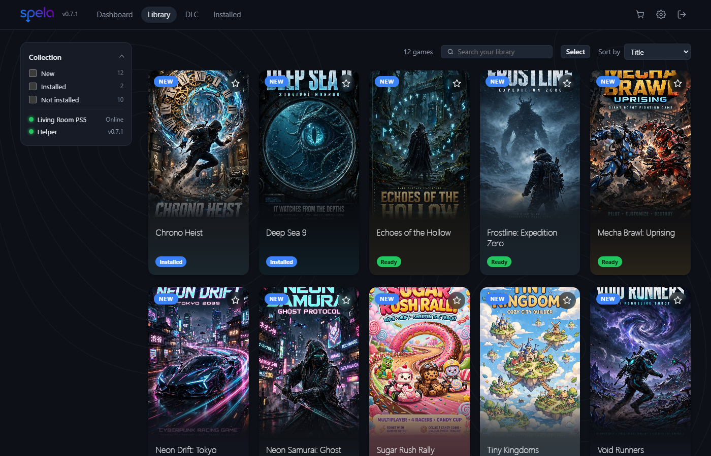
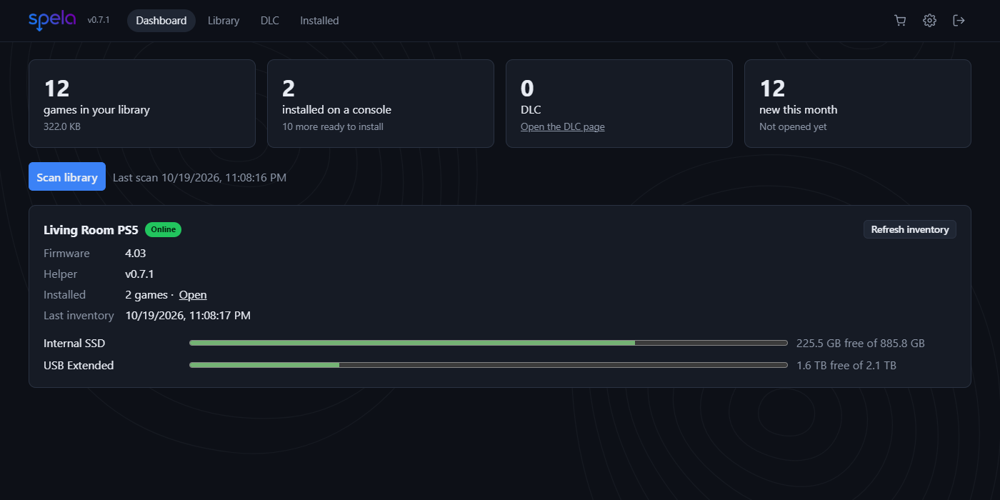
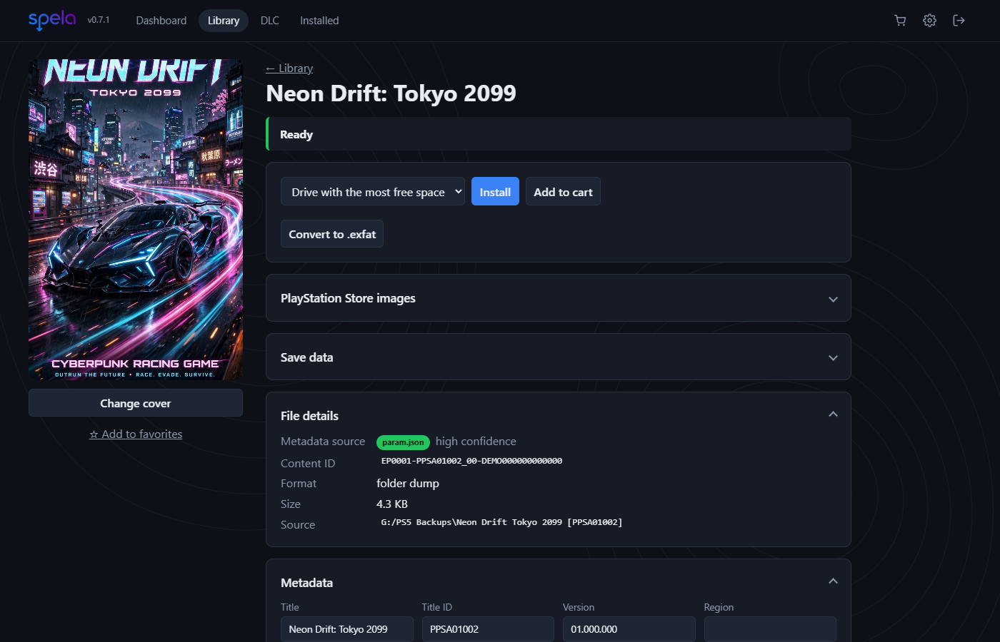
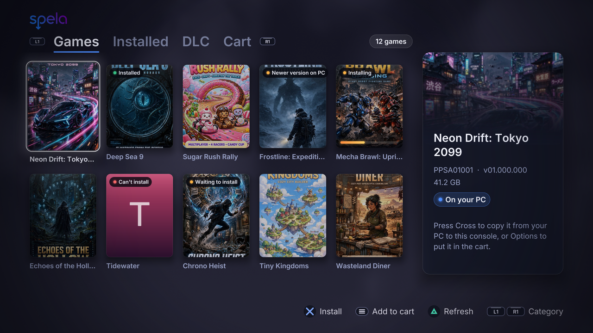
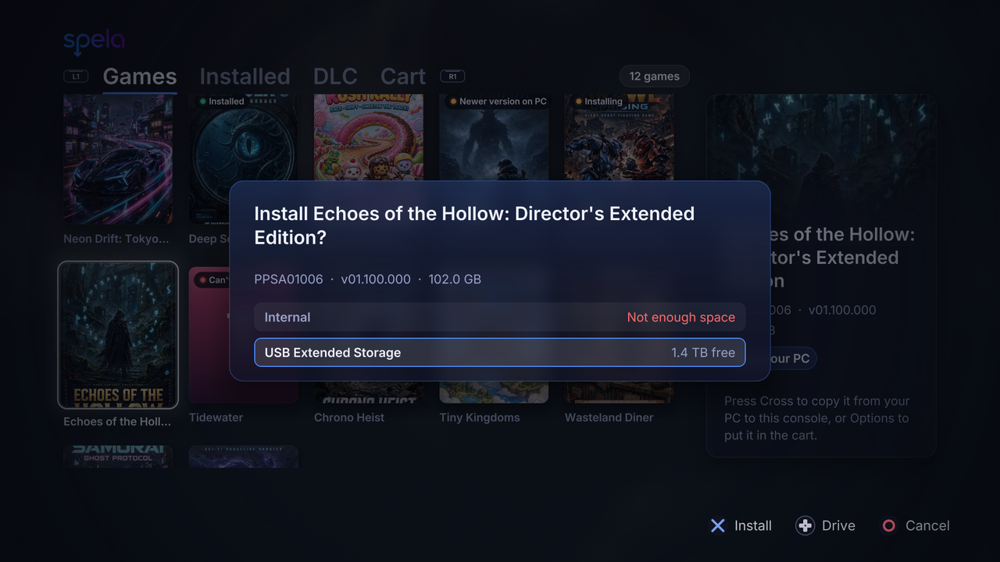
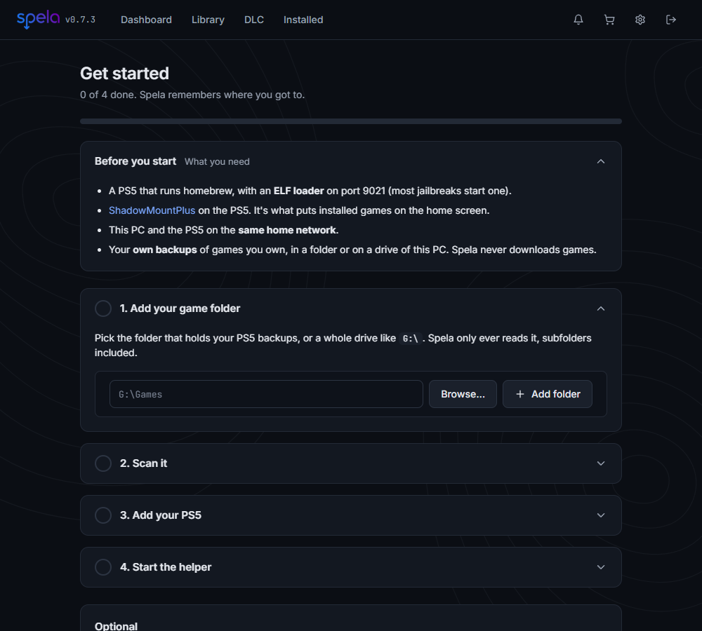
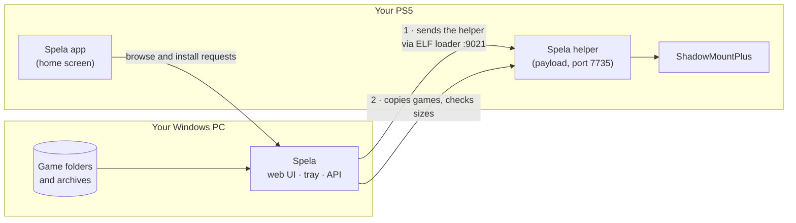

<div align="center">


**A storefront for your own PS5 game backups.**
Browse them on your PC, install them to your console over your home network, remove them again.

[](https://github.com/ensamvarg360/spela/releases/latest)
[](https://github.com/ensamvarg360/spela/actions/workflows/ci.yml)
[](LICENSE)

[](#credits)



</div>

*Spela* is Swedish for "play". It's a single-user app that lives on your PC, keeps a catalog of the PS5 game dumps you've backed up, and copies them to a PS5 that already runs homebrew, through [ShadowMountPlus](https://github.com/drakmor/ShadowMountPlus). It also puts a small **Spela app on the console's home screen**, so you can pick and install games with the controller, from the couch.

> [!IMPORTANT]
> ## Spela does not provide games. Ever.
> It contains no game files, no keys, no firmware and no Sony code. It can't download games, search for them or point you to them, and it never will. It only works with files that **you** already have on your own PC, from backups **you** made of games **you** own. The only game data it ever moves is *your* files, from *your* PC to *your* console on *your* network.
> It is not affiliated with or endorsed by Sony Interactive Entertainment. See [Legal](#legal).

## What it does

- **Finds your games.** Point it at a folder or a whole drive. It recognizes folder dumps, disc images (`.exfat`, `.ffpkg`, `.ffpfs`, `.ffpfsc`) and `.zip` / `.7z` / `.rar` archives holding them, by looking *inside* the files, not just at their names. Anything it can't identify is flagged instead of guessed.
- **Looks good.** Posters, publisher, release year, genre and rating come from PlayStation Store by title ID, no account needed. Upload your own cover if you like.
- **Installs over your network.** One click (or a whole selection) copies a game to the console's internal drive or a USB drive. It copies under a hidden name, checks every file's size, and only then renames it into place, so ShadowMountPlus never sees half a game.
- **Removes cleanly.** Deleting a ShadowMountPlus game on the PS5 leaves its files behind. Spela shows exactly what it will delete, deletes only that, and takes the home-screen tile with it.
- **Moves games between drives** on the console itself, without sending anything over the network.
- **Fixes the home screen.** Installed games get their proper logo on the PS5 home screen, which a jailbroken console can't fetch itself.
- **Handles DLC.** Installs DLC unlockers into a game's folder; keeps DLC in its own list.
- **Backs up save data** from the console to your PC, and converts folder dumps to `.exfat` images in plain Python (no OSFMount, WSL or admin rights).
- **Wakes the console** from rest mode, and re-sends its helper by itself after the console restarts.
- **Has a PS5 app.** Games, Installed, DLC and a cart on the TV, with Cross to install and Square to stop or remove.
- **Stays private.** Runs in the tray, answers only to your PC by default, and can give a phone or a guest a view-only password.

## Screenshots

<table>
  <tr>
    <td width="50%"><br><sub><b>Dashboard</b>: what's in the library, how each console and drive is doing, what needs a look.</sub></td>
    <td width="50%"><br><sub><b>Game page</b>: choose a drive, install, convert, see exactly where the files came from.</sub></td>
  </tr>
  <tr>
    <td width="50%"><br><sub><b>On the PS5</b>: the games on your PC, with what's installed, updatable or in progress.</sub></td>
    <td width="50%"><br><sub><b>Pick a drive</b> and press Cross. The one with the most free space is chosen for you.</sub></td>
  </tr>
  <tr>
    <td colspan="2" align="center"><br><sub><b>Setup guide</b>: the first run, one step at a time, picking up where you left off.</sub></td>
  </tr>
</table>

<sub>The screenshots show invented games with invented posters, kept in `docs/screenshots/demo-covers/`. `docs/screenshots/make_screenshots.py` rebuilds the PC ones from a demo library, and `./console-app/build.ps1 -Preview` renders the PS5 ones.</sub>

## What you need

- A **Windows 10 or 11** PC. (The code is plain Python and also runs on Linux with `cd backend && python launcher.py`, but the packaged app is Windows only.)
- A **PS5 that already runs homebrew**: an ELF loader listening on port 9021 and ShadowMountPlus (1.7 or later for the cleanest removals). Spela doesn't jailbreak anything and can't help you do it.
- The PC and the console on the **same home network**.

## Get started

1. Download **`Spela-<version>.exe`** from the [latest release](https://github.com/ensamvarg360/spela/releases/latest) and double-click it. There's nothing to install. Windows may show a SmartScreen warning because the app isn't code-signed; the release has a `SHA256SUMS.txt` to check your download against.
2. Choose an admin password. The **setup guide** opens and takes you through the rest, one step at a time:
   - add your game folder (or a whole drive such as `G:\`) and scan it
   - add your PS5: Spela can find it on your network, or you type its IP address
   - run your jailbreak's ELF loader, and Spela sends its helper to the PS5 by itself
   - install a game

   You can leave halfway: the guide remembers where you got to, and stays on the Dashboard until you're done. When something goes wrong, it says what to check.
3. Optional: tick **Allow other devices on my network** in the tray menu, then click **Install PS5 app** under **Settings → Consoles** to get Spela on the console's home screen.

Everything Spela knows is kept in `%LOCALAPPDATA%\Spela`. Your game files never are. The full walkthrough, backups, and a troubleshooting table are in the **[user guide](docs/user-guide.md)**.

## How it works



The **helper** is a small C payload (see [payload/main.c](payload/main.c)) that the app sends through your ELF loader. It reports firmware and free space, lists installed games, and copies, moves and deletes files, and nothing else. Like any payload, it stops when the console restarts; Spela sends it again by itself once the loader is back. An FTP payload also works as a fallback.

## Safety

Spela touches a game console, so it's built to be careful:

- **LAN only.** It listens on `127.0.0.1` unless you opt in to your home network, refuses requests addressed to a host name (so a malicious website can't reach it by DNS rebinding), and must never be exposed to the internet.
- **The helper only writes where it should.** Changes are limited to the `homebrew` folders on the console's drives, plus the one logo file and database column of a game the console already has. Everything else on the console is read-only to it.
- **Only your PC can talk to it.** Each helper copy carries a key made for that console and PC; requests without it are refused, and so are requests from web pages. An unpaired helper refuses everything.
- **Verified copies and explicit removals.** Installs are checked file by file before they appear. Removals show the exact path first, need a typed confirmation, and are written to an audit log. Your PC copy and your save data are never deleted.
- **Passwords done properly.** The admin password is stored as a salted PBKDF2 hash, logins are rate-limited, and console passwords are encrypted at rest.

Found a security problem? Please read [SECURITY.md](SECURITY.md) first.

## What it doesn't do

- **`.pkg`** installs are untested and limited to firmware 11.60 and lower: the helper starts the console's own package installer, and fake packages don't launch on newer firmware yet.
- It doesn't build FPKGs, and only converts folder dumps to `.exfat`.
- It doesn't restore save data (backing up only), because restoring would mean letting the helper write outside `homebrew`.
- It's built for **one user at home**, not for hosting a library for other people.

## Build it yourself

You need Python 3.12+ and Node 22; Docker Desktop only if you change the helper or the PS5 app.

```powershell
./build.ps1                       # dist\Spela-<version>.exe
```

```sh
# run from source: backend (Python 3.12+), data goes to ./data
cd backend && python -m venv .venv && .venv/Scripts/pip install -e ".[test]"
DATA_DIR=../data .venv/Scripts/uvicorn app.main:app --reload
.venv/Scripts/pytest

# frontend, proxying /api to :8000
cd frontend && npm install && npm run dev
```

Contributions are welcome: see [CONTRIBUTING.md](CONTRIBUTING.md), including how releases are made. The original design is in [project.md](project.md); [docs/manual-test.md](docs/manual-test.md) is the checklist run on a real PS5 before each release.

## Legal

**Spela provides no game files, at any point:** not in the download, not in the app, not through any link or setting. The only things it fetches from the internet are public cover art, ratings and logos from PlayStation Store for games you already have.

Spela is a file manager and installer for content you already have. **You are responsible for making sure that what you copy to your console is a backup you're entitled to make and use** where you live. The project doesn't include or link to any copyrighted game, key or firmware, and doesn't support piracy. "PlayStation" and "PS5" are trademarks of Sony Interactive Entertainment; they're used here only to say what the software works with.

The software is provided as is, without warranty, under the GPL. Running homebrew can have consequences for your console and your account. That risk is yours.

## Credits

- **Spela is AI-assisted.** Most of its code, from the backend and frontend to the PS5 app and helper, was written by Claude (Anthropic's AI) through [Claude Code](https://claude.com/claude-code), with ensamvarg360 directing the work, deciding what it should do and testing it on real consoles. Commits Claude worked on carry a `Co-Authored-By: Claude` line.
- The PS5 app is built on [ps5-homebrew-ui](https://github.com/blackbearreloaded/ps5-homebrew-ui) (GPL-3.0-or-later) and the [PS5 Payload SDK](https://github.com/ps5-payload-dev/sdk) (GPL-3.0); the fonts it bundles keep their own licenses, next to them in [backend/app/console_app/PPSA99787/assets/fonts](backend/app/console_app/PPSA99787/assets/fonts).
- [ShadowMountPlus](https://github.com/drakmor/ShadowMountPlus) does the actual mounting on the console. [Chiaki-ng](https://github.com/chiaki-ng/chiaki-ng) is how you get the Remote Play key for the Wake button.
- The helper links the public-domain [SQLite](https://www.sqlite.org/) to set home-screen logos.
- Game art, ratings and metadata come from PlayStation Store's public catalog.

## License

[GPL-3.0-or-later](LICENSE). Copyright © 2026 ensamvarg360 and Spela contributors.
